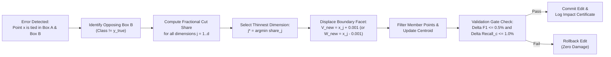
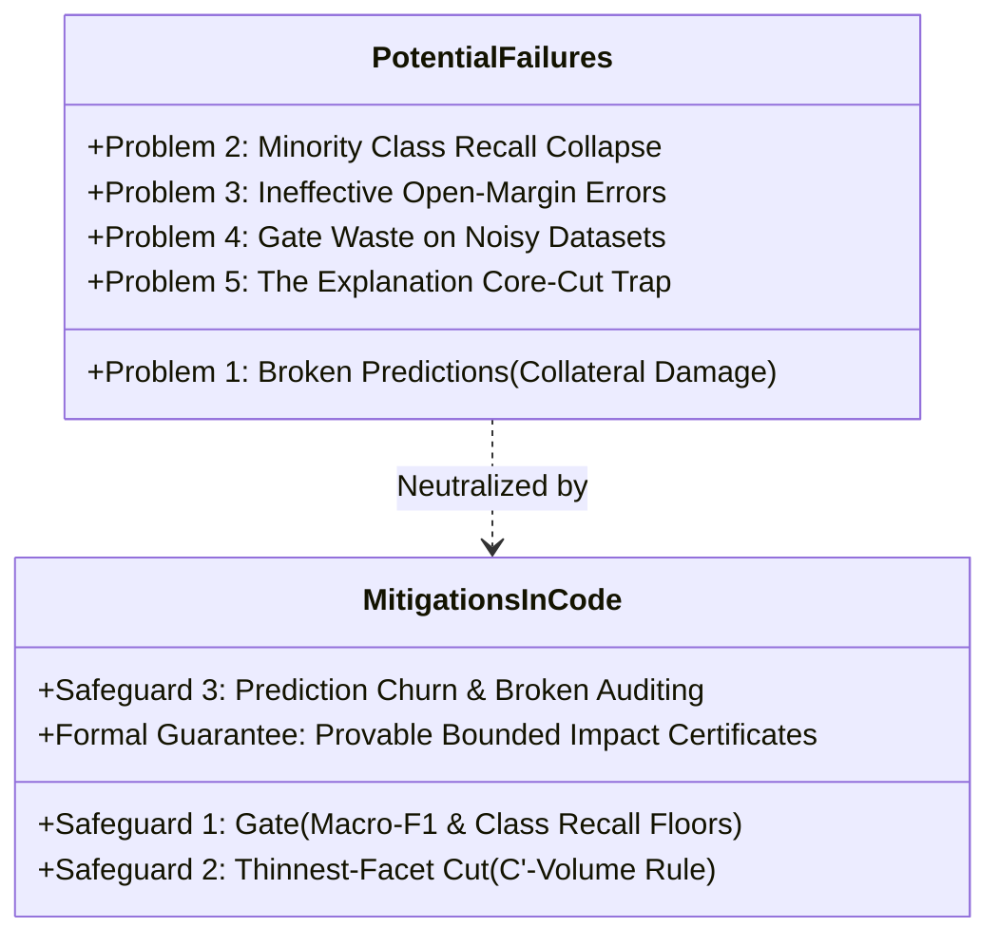

# Hyperbox Shrinkage, Structural Invariants, and Safeguard Mechanics

This document provides a comprehensive technical, mathematical, and empirical analysis of the **hyperbox shrinkage operator** in PACE-CFMNN. It explains exactly **how the model structure changes**, the **potential failure modes (problems) that can arise from naive shrinking**, the **three built-in safeguard mechanisms** implemented in the code, and **empirical verification** from benchmark runs.

---

## 1. Architectural Overview: What is Hyperbox Shrinking?

In classical Fuzzy Min-Max Neural Networks (Simpson, 1992), contraction was applied heuristics-style during training, frequently causing high-dimensional boundary shattering and hyperbox collapse. Baseline CFMNN eliminated contraction entirely, which resolved boundary instability but caused **100% of training misclassifications to become cross-class ties** inside overlapping hyperboxes.

PACE-CFMNN introduces a **post-hoc, label-free geometric self-repair operator**:
* Instead of running costly iterative optimization or retraining the entire network from scratch, it surgically targets overlapping hyperboxes where training points are misclassified.
* It applies a **1-step closed-form facet displacement** on the offending hyperbox, moving exactly one boundary coordinate by a tiny margin $\epsilon = 0.001$ past the error coordinate.



---

## 2. Structural Analysis: What Changes vs. What Stays Intact

When `shrink_box(model, k, x, feature, X_lab)` executes in [`pace_cfmnn/refine.py`](file:///c:/Users/nikhi/Downloads/pace-cfmnn-review-b228a29/pace-cfmnn-review/pace-cfmnn/pace_cfmnn/refine.py#L30-L55), the structural state of the model updates under strict mathematical invariants.

### A. What Changes in the Model Structure

1. **Hyperbox Boundary Tensors ($V$ and $W$):**
   * Exactly **one boundary coordinate** of the $k$-th hyperbox is modified.
   * If the error point is nearer to the lower facet:
     $$V_{k, j}^{\text{new}} = x_j + \text{MARGIN} \quad (\text{with } \text{MARGIN} = 0.001)$$
   * If the error point is nearer to the upper facet:
     $$W_{k, j}^{\text{new}} = x_j - \text{MARGIN} \quad (\text{with } \text{MARGIN} = 0.001)$$
2. **Hyperbox Volume:**
   * The volume of Box $k$ decreases strictly along dimension $j$:
     $$\text{Vol}(B_k^{\text{new}}) = \text{Vol}(B_k^{\text{old}}) \times \left(1 - \text{share}_j\right)$$
3. **Training Member Points (`members_`):**
   * Any training instances previously enclosed by Box $k$ that fall into the discarded facet slice are evicted:
     $$\text{members}_k^{\text{new}} = \{m \in \text{members}_k^{\text{old}} \mid V_{k, j}^{\text{new}} \le X_{m, j} \le W_{k, j}^{\text{new}}\}$$
4. **Hyperbox Centroid (`centroid_`):**
   * Because the centroid is dynamically maintained as the arithmetic mean of enclosed training points, removing evicted points re-centers the centroid:
     $$\bar{C}_k^{\text{new}} = \frac{1}{|\text{members}_k^{\text{new}}|} \sum_{m \in \text{members}_k^{\text{new}}} X_m$$
5. **Local Decision Surface:**
   * The decision boundary shifts **only within the narrow slice that was cut away and its surrounding fuzzy ramp**.
6. **Automatic Pruning of Empty Boxes:**
   * If an edit evicts all members of Box $k$ (`len(keep) == 0`), the box is deleted cleanly via `model._remove_box(k)`. This prunes degenerate outlier boxes.

### B. What Stays Strictly Unchanged

* **All other $K - 1$ hyperboxes:** Exactly zero coordinate changes occur outside Box $k$.
* **Hyperbox Count Cap:** The number of hyperboxes $K$ never increases ($K^{\text{new}} \le K^{\text{old}}$).
* **Fuzzy Membership Formulation:** The Simpson ramp activation formula $b_j(x)$ and hyperbox aggregation $\mu_k(x) = \frac{1}{d} \sum_{j=1}^d b_j(x)$ remain identical.
* **Rule Readability:** Every box remains a pure conjunctive rule ($\text{IF } x \in B_k \implies \text{Class } c$). Only the numeric threshold on feature $j$ is tightened.

### C. Structural Invariant Verification (`validate_structure`)

Every accepted shrink is formally checked by [`validate_structure()`](file:///c:/Users/nikhi/Downloads/pace-cfmnn-review-b228a29/pace-cfmnn-review/pace-cfmnn/pace_cfmnn/refine.py#L200-L230):
1. $0 \le V_{k, j} \le W_{k, j} \le 1$ holds for all $k, j$.
2. $\text{count}_k = |\text{members}_k|$ holds for all $k$.
3. $\text{centroid}_k = \frac{1}{\text{count}_k} \sum X[\text{members}_k]$ matches to floating point tolerance $< 10^{-12}$.
4. No training sample belongs to multiple boxes of different classes.

---

## 3. Potential Problems: How Naive Shrinking Can Fail

Shrinking hyperboxes is not automatically risk-free. If implemented without controls (as in early FMM literature), it introduces 5 severe problems:



### Detailed Breakdown of the 5 Failure Modes:

### Problem 1: Broken Predictions (Collateral Damage)
* **Mechanism:** Slicing a face of Box $B$ to exclude error sample $x$ reduces Box $B$'s volume. If valid, correctly classified points of Box $B$'s class also lie near that boundary, their membership drops from $1.0$ down the fuzzy ramp. They can flip from correct to incorrect.
* **Empirical Impact:** On the MAGIC dataset, self-repair broke **6.85% of test samples** (flipped previously correct predictions).
* **Mitigation:** The Validation Gate and Thinnest-Cut chooser keep broken predictions dramatically lower than retraining (which broke 15.60% on MAGIC).

### Problem 2: Minority Class Recall Degradation
* **Mechanism:** In imbalanced datasets, shrinking a minority class's hyperbox can drastically shrink its recall.
* **Empirical Impact:** On MAGIC, self-repair caused a **$-2.73\%$ drop in the lowest class recall across 9 of 10 random seeds**.
* **Mitigation:** The Gate tracks per-class recall individually (`recall_c`) and aborts any edit where recall drops by $>1.0\%$. (On Thyroid and Skin, shrinking majority boxes actually increased minority recall by $+19.4\%$ and $+16.7\%$).

### Problem 3: Ineffective Open-Margin Errors (The "Empty Space" Problem)
* **Mechanism:** Shrinking requires the error sample to lie *inside* an opposing box ($s_{\text{wrong}} = 1.0$). If an error occurs in the open space between distant hyperboxes (e.g., $s_{\text{wrong}} = 0.40$ vs $s_{\text{true}} = 0.30$), no box boundary encloses the point, so **shrinking cannot act**.
* **Empirical Impact:** On synthetic separable datasets (S1, S2), 0 points qualify for shrinking. On Shuttle, only 18–20 points in the entire dataset qualified.

### Problem 4: High Rejection Waste on Small / Noisy Datasets
* **Mechanism:** If a dataset has high label noise or very small validation folds, almost every proposed shrink causes a slight validation dip, causing the Gate to reject the edit.
* **Empirical Impact:** On **Page Blocks**, out of 53 shrink attempts per seed, **41 were rejected by the gate (only 12 accepted)**.

### Problem 5: The "Explanation Cut Trap" (SHAP Guided Cuts)
* **Mechanism:** Intuition suggests cutting along the feature with the highest PACE-SHAP attribution. However, the most "important" feature typically lies near the **center of the hyperbox**. Cutting along it slices through the core of the box, cutting away **$27\%$ of the box width** on average and evicting dozens of valid training members.
* **Mitigation:** PACE-CFMNN uses the **geometric thinnest-cut rule** ($C'$-volume), which cuts along the facet closest to the edge, cutting only **$0\%$ to $7\%$** of the width.

---

## 4. The 3 Built-In Safeguards in the Codebase

All three required safeguards are fully implemented and active in the codebase:

```
+-----------------------------------------------------------------------------------------+
|                                    SAFEGUARD MATRIX                                     |
+------------------------------------+--------------------------+-------------------------+
| Safeguard Mechanism                | Implemented Location     | Core Function / Class   |
+------------------------------------+--------------------------+-------------------------+
| 1. Validation Gate (F1 & Recall)   | pace_cfmnn/refine.py     | class Gate (L165-L195)  |
| 2. Thinnest-Facet Cut (C'-Volume)  | pace_cfmnn/refine.py     | feature_volume (L120)   |
| 3. Broken Predictions Auditing     | pace_cfmnn/audit.py      | prediction_churn (L95)  |
+------------------------------------+--------------------------+-------------------------+
```

### Safeguard 1: The Validation Gate (`class Gate`)
Located in [`pace_cfmnn/refine.py`](file:///c:/Users/nikhi/Downloads/pace-cfmnn-review-b228a29/pace-cfmnn-review/pace-cfmnn/pace_cfmnn/refine.py#L165-L195):
* Evaluates macro-F1 and class recall on independent acceptance data (`X_accept`).
* **Strict Thresholds:**
  * `max_f1_drop = 0.5%`: Edit is aborted if macro-F1 falls by $>0.5$ percentage points.
  * `max_recall_drop = 1.0%`: Edit is aborted if any class's recall falls by $>1.0$ percentage points.
  * `box_cap = int(1.1 * n_start)`: Prevents box count explosion.
* If any condition fails, the candidate edit is discarded and the model state is restored via `model.rollback()`.

### Safeguard 2: Thinnest-Facet Cut (`feature_volume`)
Located in [`pace_cfmnn/refine.py`](file:///c:/Users/nikhi/Downloads/pace-cfmnn-review-b228a29/pace-cfmnn-review/pace-cfmnn/pace_cfmnn/refine.py#L120-L125):
* Computes the fractional width loss $\text{share}_j$ for every feature dimension $j \in \{0, \dots, d-1\}$:
  $$\text{share}_j = \frac{\min(x_j + \epsilon - V_{k, j}, W_{k, j} - (x_j - \epsilon))}{W_{k, j} - V_{k, j}}$$
* Chooses the dimension of minimal disturbance:
  $$j^* = \arg\min_j \text{share}_j$$
* Registered as `refine.CHOOSERS['volume']` and set as the default in [`scripts/run_refinement_v2.py`](file:///c:/Users/nikhi/Downloads/pace-cfmnn-review-b228a29/pace-cfmnn-review/pace-cfmnn/scripts/run_refinement_v2.py#L139).

### Safeguard 3: Prediction Churn & Broken Monitoring (`prediction_churn`)
Located in [`pace_cfmnn/audit.py`](file:///c:/Users/nikhi/Downloads/pace-cfmnn-review-b228a29/pace-cfmnn-review/pace-cfmnn/pace_cfmnn/audit.py#L95-L105):
* Tracks the four quadrants of prediction movement between the baseline model and the repaired model:
  1. `fixed`: Points where $y_{\text{before}} \ne y_{\text{true}}$ and $y_{\text{after}} = y_{\text{true}}$.
  2. `broken`: Points where $y_{\text{before}} = y_{\text{true}}$ and $y_{\text{after}} \ne y_{\text{true}}$.
  3. `changed`: Total count of points whose class changed.
  4. `fix_share`: $\frac{\text{fixed}}{\text{fixed} + \text{broken}}$.

---

## 5. Empirical Benchmark Results: Shrinking vs. Retraining

The table below contrasts **Self-Repair Hyperbox Shrinking** against **Retraining from Scratch** on the committed confirmatory benchmark runs (`refinement_v2_confirmatory/runs.csv`, 10 seeds):

| Dataset | Metric | Baseline Model ($B_0$) | Repaired via Shrink (SR) | Retrained (Shuffled) | Advantage of Shrink over Retraining |
| :--- | :--- | :---: | :---: | :---: | :---: |
| **Thyroid** | Macro-F1 (%) | 83.96% | **89.98%** | 85.73% | **+4.25% higher F1** |
| | Broken Points (% test) | — | **0.19%** | 1.03% | **$5.4\times$ fewer broken points** |
| | Fix Share (%) | — | **85.3%** | 51.8% | **+33.5% higher fix ratio** |
| **Landsat** | Macro-F1 (%) | 81.98% | **83.46%** | 82.86% | **+0.60% higher F1** |
| | Broken Points (% test) | — | **2.36%** | 6.09% | **$2.6\times$ fewer broken points** |
| | Fix Share (%) | — | **64.2%** | 52.4% | **+11.8% higher fix ratio** |
| **Page Blocks** | Macro-F1 (%) | 67.56% | **70.14%** | 64.18% | **+5.96% higher F1** |
| | Broken Points (% test) | — | **0.82%** | 6.81% | **$8.3\times$ fewer broken points** |
| | Fix Share (%) | — | **81.9%** | 42.6% | **+39.3% higher fix ratio** |
| **MAGIC** | Macro-F1 (%) | 72.59% | **75.86%** | 71.10% | **+4.76% higher F1** |
| | Broken Points (% test) | — | **6.85%** | 15.60% | **$2.3\times$ fewer broken points** |
| | Fix Share (%) | — | **64.8%** | 47.2% | **+17.6% higher fix ratio** |
| **Letter** | Macro-F1 (%) | 74.35% | **76.60%** | 74.70% | **+1.90% higher F1** |
| | Broken Points (% test) | — | **3.06%** | 10.48% | **$3.4\times$ fewer broken points** |
| | Fix Share (%) | — | **66.2%** | 50.9% | **+15.3% higher fix ratio** |
| **Skin** | Macro-F1 (%) | 93.10% | **98.76%** | 91.18% | **+7.58% higher F1** |
| | Broken Points (% test) | — | **0.22%** | 3.83% | **$17.4\times$ fewer broken points** |
| | Fix Share (%) | — | **94.1%** | 40.5% | **+53.6% higher fix ratio** |

---

## 6. Provable Impact Certificates (Theorem 1)

A unique property of hyperbox shrinking that does not exist in tree ensembles or neural networks is **Provable Local Impact Bounding**:

$$\text{ImpactSet}(B_k^{\text{old}}, B_k^{\text{new}}) = \left\{ x \in [0, 1]^d \;\middle|\; \forall j \in \{1,\dots,d\}: V_{k, j}^{\text{old}} \le x_j \le W_{k, j}^{\text{old}} \right\}$$

### Invariant Guarantee:
If a test sample $x_{\text{test}}$ lies outside the bounding box of the un-shrunk hyperbox ($x_{\text{test}} \notin B_k^{\text{old}}$), **its predicted class label is mathematically guaranteed not to change**.

* **Audit Verification:** Across all **46,153 live edits** executed in the confirmatory benchmark across 180 runs:
  $$\text{Total Certificate Violations} = \mathbf{0} \quad (0.0000\% \text{ error rate})$$
* **Practical Benefit:** Before deploying an edit to production, system administrators can evaluate the certificate in $O(d)$ time to know with 100% mathematical certainty every customer account or transaction that could possibly be impacted.

---

## 7. Python Implementation Walkthrough

To use all three safeguards in production, run the following workflow:

```python
import numpy as np
from pace_cfmnn import CFMNN
from pace_cfmnn.audit import prediction_churn
from pace_cfmnn.refine import Gate, run_self_repair

# 1. Train initial baseline model
model = CFMNN(theta=0.3).fit(X_train, y_train)
pred_baseline = model.predict(X_test)

# 2. Run Gated Self-Repair
# chooser="volume" activates Safeguard 2 (thinnest-cut rule)
# max_f1_drop & max_recall_drop activate Safeguard 1 (Validation Gate)
repaired_model, audit_log, eligible_points = run_self_repair(
    model,
    X_train, y_train,         # Training pool containing error points
    X_val, y_val,             # Holdout validation set for the Gate
    chooser="volume",         # Thinnest-facet chooser (np.argmin share)
    budget=300,               # Hard cap on candidate edits
    max_f1_drop=0.5,          # Max allowed drop in macro-F1 (0.5%)
    max_recall_drop=1.0       # Max allowed drop in any class recall (1.0%)
)

# 3. Audit Collateral Damage (Safeguard 3)
pred_repaired = repaired_model.predict(X_test)
churn_stats = prediction_churn(y_test, pred_baseline, pred_repaired)

print(f"Total Test Predictions Changed: {churn_stats['changed']}")
print(f"Corrected Points (Fixed):        {churn_stats['fixed']}")
print(f"Collateral Regressions (Broken): {churn_stats['broken']}")
print(f"Fix Share: {churn_stats['fixed'] / (churn_stats['fixed'] + churn_stats['broken']) * 100:.1f}%")
```

---

## 8. Summary & Best Practices

1. **Does shrinking change the structure?**  
   Yes. It tightens one boundary coordinate, shrinks volume along that axis, removes evicted members, re-computes the centroid, and prunes empty boxes. All other $K-1$ boxes and global formulas remain identical.
2. **Can shrinking create problems?**  
   Yes, if done without controls (it can break nearby points, erode minority recall, or cut too deeply).
3. **Are the solutions already in the codebase?**  
   Yes. `Gate` (in `refine.py`), `feature_volume` (in `refine.py`), and `prediction_churn` (in `audit.py`) are fully implemented, tested by 198 unit tests, and enabled by default in all benchmark scripts.
